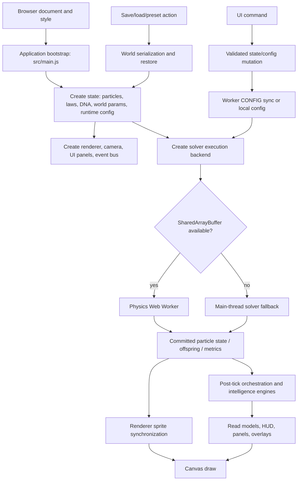
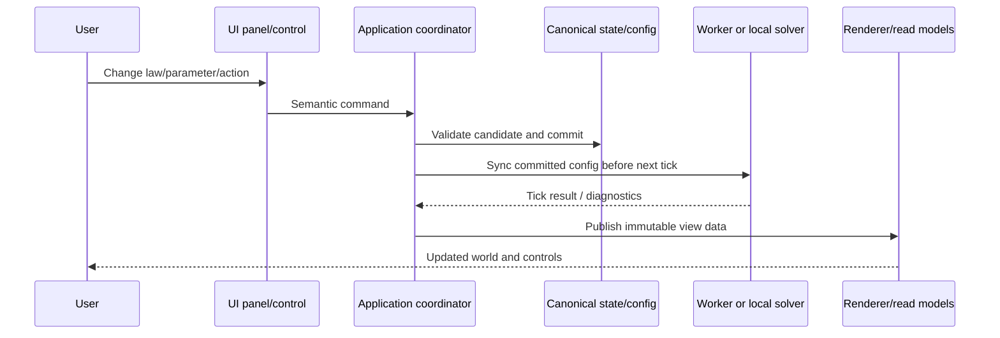

# VEPA operation map

This is the initial architectural map inferred from the stable repository structure and product documentation. Function-level call graphs must be filled in from the pinned source before the corresponding modules are ported.

## High-level runtime pipeline

## State ownership

| State domain | Stable owner/source family | Consumer(s) | Port rule |
|---|---|---|---|
| Particle positions, velocities, mass, energy and per-particle attributes | `src/state/particleBuffer.js` | Solver, worker, renderer, engines | One authoritative buffer; renderer consumes projection only |
| Law activation and law metadata | `src/state/lawState.js`, `src/constants.js`, law registry | Solver dispatch, law panel, help | One canonical law index/metadata authority; UI must not invent law state |
| Species DNA and phenotype | `src/dna/dnaBuffer.js`, `src/dna/expression.js` | Solver, spawn, species/DNA panels | Preserve packed layout and decoding semantics; version the schema |
| World/environment parameters | `src/state/worldParams.js`, runtime config | Solver, fields, UI, worker | Stage/validate/commit; synchronize worker before next tick |
| Presets and species roster | `src/state/defaultPresets.js`, `presetManager.js` | Setup UI, world boot/restart | Preset application is one transaction, not a collection of unrelated writes |
| Persistent world state | `src/state/worldSave.js` | Save panel, import/export, startup | Versioned schema, integrity validation, atomic restore |
| Intelligence/ecology/civilization state | `src/engines/*`, `src/state/*` | Dashboard and data panels | Separate authoritative domain state from derived read models |

## Simulation tick pipeline

The exact function sequence must be traced from `src/physics/solver.js` and `src/worker/physics.worker.js`. Use this order as the inspection checklist, not as a claim of exact current source order:

1. Receive tick request with dt, law state, world config and DNA/config revision.
2. Establish deterministic iteration/random context.
3. Build or update spatial acceleration structures.
4. Apply per-particle forces and field interactions.
5. Traverse neighbor/pair interactions and apply active law groups.
6. Apply signal/communication exchange where enabled.
7. Apply contact constraints, collisions, merges/accretion and lifecycle transitions.
8. Integrate positions/velocities and apply world boundaries.
9. Process reproduction/offspring allocation and identity/species updates.
10. Validate finite state and commit tick outcome.
11. Return metrics, offspring and compact render/read-model data.
12. On main thread, update engines on their configured cadences, publish events, synchronize sprites and render.

Every step must be confirmed against source and documented with function names, state inputs/outputs, mutation ownership, cadence and tests.

## Browser event and command pipeline

## Save/load pipeline

- Save: capture authoritative world state at a safe tick boundary → include version/schema, particle buffer, species/DNA, laws, world params, PRNG, engine state, timeline/history and required metadata → validate/encode → persist/export → verify round-trip.
- Load: parse untrusted payload → validate envelope/checksum/schema → migrate explicitly → stage candidate → stop or pause execution at safe boundary → atomically replace runtime state → sync worker → restore read models → resume only after successful commit.
- Undo/restore: use explicit snapshot/transaction semantics; do not partially mutate live state before validation completes.

## Render pipeline

- Simulation owns truth. Renderer owns only camera, interpolation and visual projections.
- Particle buffer → sprite sync/projection → Canvas renderer.
- HUD/panels/overlays consume metrics and read models.
- Camera, selection, panel visibility and debug display are UI state, not simulation state.
- Rendering quality adaptation must never alter physics outcomes.

## Required function-level trace template

For each source module, record:
- exported functions/classes and their callers;
- imported modules and side effects;
- authoritative state read/written;
- execution phase/cadence;
- worker/main-thread boundary;
- errors, rollback and finite-value handling;
- deterministic inputs/random consumption;
- tests and source fixtures;
- UI controls that invoke or observe it.
