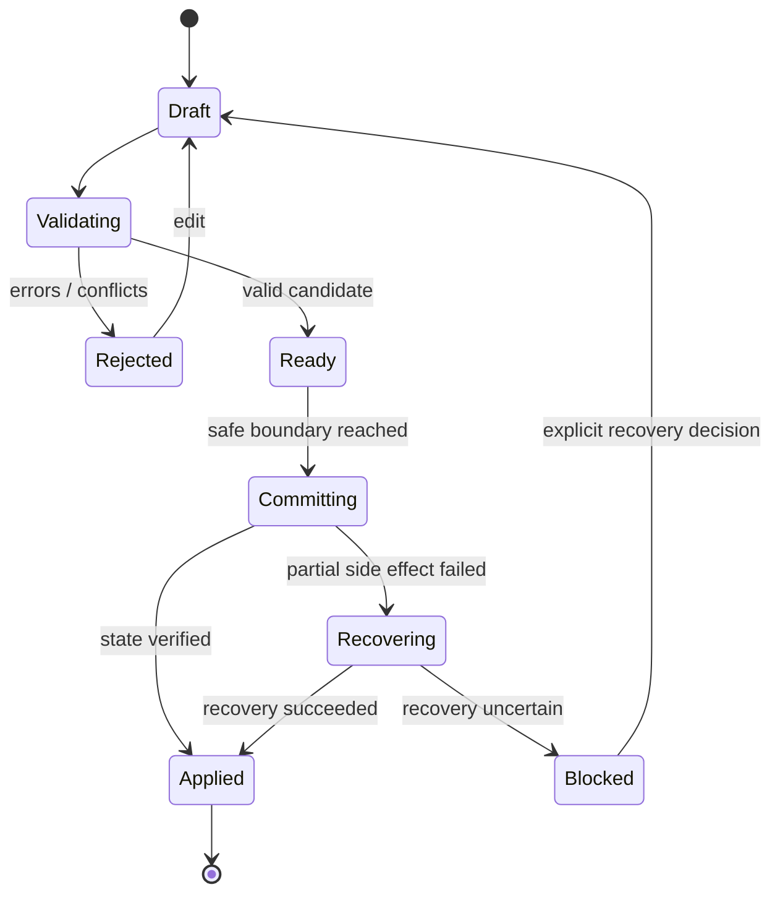

# VEPA Next SIM Architecture

**Status:** target contract, implementation partial.  
**SIM:** Semantically Interoperable Modularization.

## Design thesis

VEPA Next should preserve the numerical efficiency of the stable simulator while making the rest of the system easier to reason about. The hot loop should remain data-oriented and allocation-conscious. Interoperability belongs at explicit module boundaries: typed configuration, law manifests, event envelopes, state transitions, diagnostics and versioned persistence.

## Layers and allowed dependencies

| Layer | Owns | May depend on | Must not do |
|---|---|---|---|
| UI / visualization | User interaction, camera, presentation | Use cases, read-only snapshots, renderer API | Mutate worker/world state directly |
| Application/use cases | User workflows, preset selection, inspection | World session, contracts | Implement physics or store duplicate authoritative state |
| World session | Lifecycle, pause/restart, generation, commit boundaries | State, transaction, execution adapter | Hide partial failure or silently coerce config |
| Domain contracts | Stable IDs, schemas, units, event/diagnostic envelopes | Minimal shared primitives | Depend on UI, storage or renderer |
| Physics core | Integrator, contacts, spatial index, particle state | Data contracts, injected deterministic services | Read wall clock or untracked random source |
| Law/domain modules | Law behavior, domain state transitions | Physics/domain interfaces and law manifest | Reach into unrelated module internals |
| Evidence plane | Event journal, derived metrics, inference provenance, replay | Committed facts and snapshots | Present inference as observed fact |
| Persistence | Save/load, migration, integrity, recovery | Versioned semantic DTOs | Serialize arbitrary mutable object graphs without schema |
| Execution adapters | Worker, CPU/GPU, scheduling | Physics and contracts | Change semantics invisibly when switching backend |
| Renderer adapters | Canvas/Pixi/WebGL, overlays | Immutable snapshots | Feed rendering simplification back into simulation |

## Semantic event envelope

A committed event should carry:
- `eventId`: stable unique event identifier.
- `type` and `schemaVersion`: namespaced semantic type and payload version.
- `worldId`, `tick`, `sequence`: deterministic ordering context.
- `sourceModule`: stable module ID.
- `payload`: schema-validated domain data.
- `causationId` / `correlationId`: optional links to command and workflow.
- `wallClockTime`: optional diagnostic metadata only; never the sole ordering key.

## Transaction lifecycle

The existing restart helper calls lifecycle callbacks sequentially without an explicit rollback boundary. Treat it as an orchestration primitive, not a complete transaction guarantee. The next implementation must stage all validation before stopping compute, preserve the last-known-good snapshot, record the phase reached, and define rollback/recovery for failures after side effects begin.

## Determinism contract

A replayable run must pin:
1. PRNG algorithm/version and state per relevant stream.
2. Initial state/spawn recipe and canonical configuration.
3. Law IDs/versions and execution order.
4. Tick/integrator rules and boundary conditions.
5. Event order, worker handoff semantics and state commit boundaries.
6. Backend/runtime compatibility and numeric tolerance.
7. Any external decision input, including optional LLM outputs, as a recorded immutable input or an explicitly non-replayable feature.

No simulation-critical code may call ambient `Math.random()` or use wall-clock time as an outcome input. Rendering may use wall time for animation interpolation only if it cannot feed back into state.

## Performance constraints

- Avoid per-particle object allocation in hot loops unless benchmarks prove it acceptable.
- Prefer typed arrays/compact structures for dense particle state.
- Avoid abstraction dispatch per particle when dispatch can be hoisted per law/tick.
- Keep contracts at batch/module boundaries; do not sacrifice numerical hot-path throughput to over-generalized interfaces.
- Benchmark stable and candidate on identical seeded fixtures and law sets.
- Report solver throughput, render frame time, memory, startup/build, and save/load separately.
- If adaptive rendering drops visual detail, show the adaptation. Never alter simulation outcomes to satisfy a frame-rate target.

## Contract acceptance

A module is SIM-ready when its identity, schema, state ownership, side effects, dependencies, deterministic inputs, error behavior and tests are declared. A subsystem is SIM-ready when integration tests verify the contract at both successful and failed boundaries. The repository is SIM-conformant only after automated dependency rules and evidence cover all production modules.
