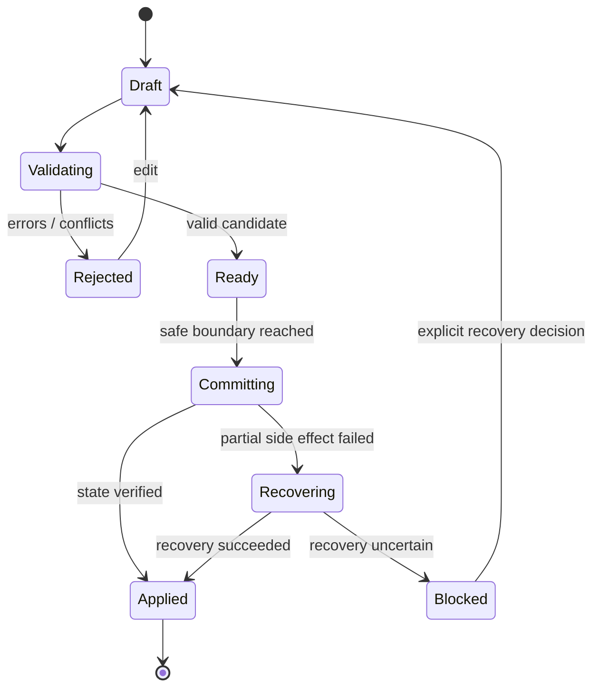

# VEPA Next SIM Architecture

**Status:** target contract, implementation partial.  
**SIM:** Semantically Interoperable Modularization.

## Design thesis

VEPA Next should preserve the numerical efficiency of the stable simulator while making the rest of the system easier to reason about. The hot loop should remain data-oriented and allocation-conscious. Interoperability belongs at explicit module boundaries: typed configuration, law manifests, event envelopes, state transitions, diagnostics and versioned persistence.

## Layers and allowed dependencies

| Layer | Owns | May depend on | Must not do |
|---|---|---|---|
| UI / visualization | User interaction, camera, presentation | Use cases, read-only snapshots, renderer API | Mutate worker/world state directly |
| Application/use cases | User workflows, preset selection, inspection | World session, contracts | Implement physics or store duplicate authoritative state |
| World session | Lifecycle, pause/restart, generation, commit boundaries | State, transaction, execution adapter | Hide partial failure or silently coerce config |
| Domain contracts | Stable IDs, schemas, units, event/diagnostic envelopes | Minimal shared primitives | Depend on UI, storage or renderer |
| Physics core | Integrator, contacts, spatial index, particle state | Data contracts, injected deterministic services | Read wall clock or untracked random source |
| Law/domain modules | Law behavior, domain state transitions | Physics/domain interfaces and law manifest | Reach into unrelated module internals |
| Evidence plane | Event journal, derived metrics, inference provenance, replay | Committed facts and snapshots | Present inference as observed fact |
| Persistence | Save/load, migration, integrity, recovery | Versioned semantic DTOs | Serialize arbitrary mutable object graphs without schema |
| Execution adapters | Worker, CPU/GPU, scheduling | Physics and contracts | Change semantics invisibly when switching backend |
| Renderer adapters | Canvas/Pixi/WebGL, overlays | Immutable snapshots | Feed rendering simplification back into simulation |

## Semantic event envelope

A committed event should carry:
- `eventId`: stable unique event identifier.
- `type` and `schemaVersion`: namespaced semantic type and payload version.
- `worldId`, `tick`, `sequence`: deterministic ordering context.
- `sourceModule`: stable module ID.
- `payload`: schema-validated domain data.
- `causationId` / `correlationId`: optional links to command and workflow.
- `wallClockTime`: optional diagnostic metadata only; never the sole ordering key.

The world-session contract now emits `world.config-committed` schema v2 with requested, prior and actual config values. Rejected, rolled-back and blocked config proposals emit explicit outcome events. These are currently in-memory and are not yet wired to the legacy physics worker.

## Transaction lifecycle

The existing restart helper calls lifecycle callbacks sequentially without an explicit rollback boundary. Treat it as an orchestration primitive, not a complete transaction guarantee. The next implementation must stage all validation before stopping compute, preserve the last-known-good snapshot, record the phase reached, and define rollback/recovery for failures after side effects begin.

## Determinism contract

A replayable run must pin:
1. PRNG algorithm/version and state per relevant stream.
2. Initial state/spawn recipe and canonical configuration.
3. Law IDs/versions and execution order.
4. Tick/integrator rules and boundary conditions.
5. Event order, worker handoff semantics and state commit boundaries.
6. Backend/runtime compatibility and numeric tolerance.
7. Any external decision input, including optional LLM outputs, as a recorded immutable input or an explicitly non-replayable feature.

No simulation-critical code may call ambient `Math.random()` or use wall-clock time as an outcome input. Rendering may use wall time for animation interpolation only if it cannot feed back into state.

## Performance constraints

- Avoid per-particle object allocation in hot loops unless benchmarks prove it acceptable.
- Prefer typed arrays/compact structures for dense particle state.
- Avoid abstraction dispatch per particle when dispatch can be hoisted per law/tick.
- Keep contracts at batch/module boundaries; do not sacrifice numerical hot-path throughput to over-generalized interfaces.
- Benchmark stable and candidate on identical seeded fixtures and law sets.
- Report solver throughput, render frame time, memory, startup/build, and save/load separately.
- If adaptive rendering drops visual detail, show the adaptation. Never alter simulation outcomes to satisfy a frame-rate target.

## Automated enforcement

The repository now runs `scripts/check-sim-boundaries.mjs` as part of `npm run check`. It rejects ambient `Math.random()`, wall-clock reads and DOM/window references in the deterministic `core`, `sim` and `state` layers, and checks the declared import direction between core, simulation and state modules. The check is intentionally conservative and currently covers JavaScript source under `src/`; it does not yet prove complete dependency closure, detect every dynamic import pattern, validate all domain payload schemas or enforce the full legacy application boundary. Its latest CI run passed at commit `d5fae63d62c3550a1238407f180ffb4d9936b6b8`.

## Legacy V3 particle-buffer migration

- `src/sim/v3-particle-migration.js` accepts only an explicit V3 64-slot interleaved particle buffer and a particle count, then returns a new Float64Array in the current 100-slot layout.
- Offsets 0–63 are copied unchanged. This preserves the 42 cached per-particle DNA values at offsets 8–49 and the remaining legacy particle fields. Appended offsets 64–99 are initialized to zero; this is an initialization policy, not a reconstruction of newer state.
- The adapter rejects unsupported typed arrays, incorrect lengths, invalid particle counts and non-finite values. It does not mutate the source.
- This adapter does not migrate the separate species-level packed DNA buffer, law bitmasks, world configuration, PRNG state, worker lifecycle or snapshot/save envelopes. Those require independent versioned contracts and source fixtures. In particular, the V3 worker's 42 named DNA traits must not be conflated with the current 64-trait species genome schema.
- Contract tests cover slot preservation, multi-particle offsets, cached DNA, zero defaults, immutability and invalid inputs. Full V3 save compatibility and stable physics parity remain unverified.

## Legacy V3 species-DNA migration

- The V3 species DNA adapter accepts a packed Uint16Array and explicit species count. Each species record is 64 uint16 values, matching the V3 worker addressing. The pinned V3 source does not declare a canonical species-buffer capacity, so missing counts and non-exact lengths are rejected.
- The 42 shared traits keep their indices. Two semantic ranges changed: trait 29 (base radius, V3 0.5–10; current 0.2–4) and trait 33 (magnetic moment, V3 0–1; current -1–1). These are decoded to floats and re-encoded rather than copied raw.
- Traits 42–63 receive current schema defaults. This is an explicit defaulting policy, not historical reconstruction.
- Tests cover unchanged trait preservation, both range conversions, appended defaults, multiple species, source immutability and malformed inputs. Fixtures are synthetic: the pinned V3 repository does not contain a canonical app-side allocator, preset or save fixture establishing capacity.
- This adapter does not migrate species metadata, particle state, law state, PRNG state or world save envelopes.

## Checkpoint serialization and recovery

- `src/state/snapshot.js` defines the versioned `vepa.world-snapshot` envelope. Schema v2 canonicalizes object keys, checks finite numeric values, detects accidental corruption with a non-cryptographic checksum, and encodes supported numeric typed arrays as tagged JSON arrays that `restoreSnapshotValue` can reconstruct.
- `src/state/snapshot-store.js` provides a two-slot key/value adapter. It writes the new slot before updating the active pointer and can recover the newest valid slot if the pointer is missing or stale.
- `createWorldSession.createSnapshot` supplies session-owned world ID, tick, generation, configuration and event cursor. `saveCheckpoint` passes that envelope to an injected store.
- The session still receives simulation buffers, PRNG state and fidelity-policy metadata from its caller. Until a worker adapter owns atomic capture/restore, a caller could supply state that does not match the live world. This is not yet a full save/reload implementation.
- Typed arrays are currently expanded to JSON arrays. This favors a portable first contract over compactness; benchmark serialization size/time and consider a binary/IndexedDB representation before persisting large worlds.
- The v2 codec is a pre-release format change. No released v1 migration is implemented.

## Contract acceptance

A module is SIM-ready when its identity, schema, state ownership, side effects, dependencies, deterministic inputs, error behavior and tests are declared. A subsystem is SIM-ready when integration tests verify the contract at both successful and failed boundaries. The repository is SIM-conformant only after automated dependency rules and evidence cover all production modules.
